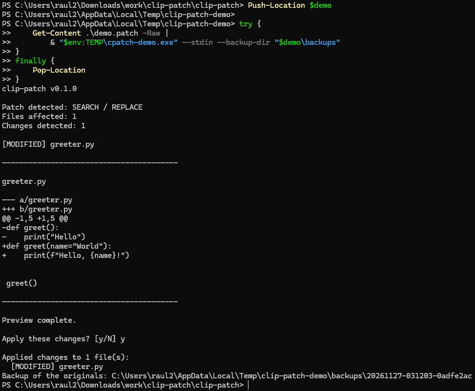
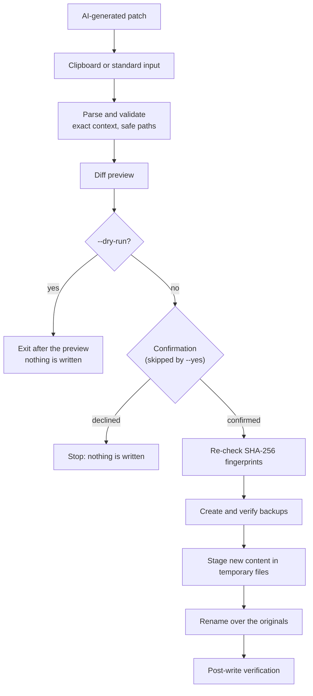

<div align="center">


# Clip-Patch

**Review and apply AI-generated code patches from your clipboard, with backups and safety checks.**

[](https://github.com/raul-alberto/clip-patch/actions/workflows/ci.yml)


</div>

---

AI assistants often answer with partial code blocks or diffs. Pasting them by hand risks wrong indentation, edits in the wrong place, and damaged files. **Clip-Patch** reads the patch from your clipboard (or standard input), checks it against your real files, shows a diff, backs up the originals, and writes only after you confirm.

It runs entirely on your machine: no network access, no API keys, no background services. It is built from the Go standard library only; both commands (`clip-patch` and `cpatch`) are standalone Go binaries and need no separate runtime.

```bash
cpatch --dry-run     # preview only
cpatch               # preview, confirm, apply
```

> The install provides two identical commands: `clip-patch` and the shorter `cpatch`.

## Demo

<p align="center">
  
</p>

## How it works



Every file is validated and every result is computed in memory before anything touches the disk. Nothing is written until you confirm. `--yes` only replaces the prompt; all checks and backups still run.

## Key features

| | |
|---|---|
| **Patch formats** | SEARCH / REPLACE blocks and unified diff (Git-style or plain), auto-detected or chosen with `--format`. |
| **Preview and confirmation** | A diff of every change before anything is written. Pressing Enter at the prompt does *not* apply. |
| **Backup and recovery** | Verified copies of the original files, with a manifest, created before any write. |
| **Path and file safety** | Paths from the patch are untrusted and cannot leave the project root. |
| **Input methods** | System clipboard on Windows, macOS and Linux, or `--stdin`. |
| **File integrity** | Exact matching only. BOM, CRLF/LF line endings and the final-newline state are preserved. |

## Installation

Requires **Go 1.21 or newer**.

```bash
git clone https://github.com/raul-alberto/clip-patch.git
cd clip-patch
go install ./cmd/clip-patch ./cmd/cpatch
```

This installs both commands into `$(go env GOPATH)/bin`. Make sure that directory is on your `PATH`.

Alternatively, build into `bin/` without installing:

```bash
make build                    # bin/clip-patch and bin/cpatch
# or, without make:
go build -o bin/ ./cmd/...
```

### Clipboard requirements

The clipboard is read through the platform's standard tool:

| OS | Tool used | Notes |
|---|---|---|
| Windows 10/11 | `powershell` (`Get-Clipboard`), falls back to `pwsh` | Built in |
| macOS | `pbpaste` | Built in |
| Linux, Wayland | `wl-paste` | Install `wl-clipboard` |
| Linux, X11 | `xclip` or `xsel` | Install one of them |

If no clipboard tool is available (for example over SSH), use `--stdin`.

## Quick start

1. Copy the AI-generated patch to your clipboard.
2. Open a terminal **in the project directory** (or pass `--root`).
3. Run one of:

```bash
cpatch --dry-run     # preview only; never modifies files
cpatch               # preview, then ask: Apply these changes? [y/N]
cpatch --yes         # apply without the prompt
```

Reading the patch from a file or pipe instead of the clipboard:

```bash
cat patch.diff | cpatch --stdin --dry-run              # Linux / macOS
Get-Content patch.diff -Raw | cpatch --stdin           # Windows PowerShell
```

- `--yes` skips only the interactive confirmation. Validation, path checks, fingerprint checks and backups still run.
- With `--stdin`, the confirmation prompt is read from the terminal, not from the pipe. If no terminal is available, pass `--yes` or `--dry-run`.
- `--dry-run` and `--yes` cannot be combined.

### Options

```text
-h, --help           Show help
    --version        Display version
    --dry-run        Preview without modifying files
    --yes            Apply without interactive confirmation (checks and backups still run)
    --format FORMAT  auto (default), search-replace, unified-diff
    --root PATH      Project root (default: current directory)
    --backup-dir PATH  Backup location (default: per-user data directory)
    --stdin          Read the patch from standard input
    --color WHEN     auto (default), always, never
```

Exit codes: `0` success (including dry run), `1` patch rejected, apply failed or declined, `2` invalid command line.

## Supported patch formats

### SEARCH / REPLACE

````text
### FILE: greeter.py

<<<<<<< SEARCH
def greet():
    print("Hello")
=======
def greet(name="World"):
    print(f"Hello, {name}!")
>>>>>>> REPLACE
````

- A `### FILE: path` header names the file for the blocks that follow. Multiple blocks and multiple files are allowed.
- Text outside blocks (explanations, code fences) is ignored.
- SEARCH is matched against the **original** file, whitespace included, and must match **exactly once**. Blocks must not overlap.
- An empty REPLACE section (no lines) deletes the matched lines.
- A line that is exactly `=======` inside a block is ambiguous and is rejected.

### Unified diff

```diff
diff --git a/greeter.py b/greeter.py
--- a/greeter.py
+++ b/greeter.py
@@ -1,2 +1,3 @@
 def greet():
-    print("Hello")
+    print("Hello, World!")
+    print("Welcome!")
```

- Multiple files and multiple hunks are supported. Git does not need to be installed.
- Line counts in `@@` headers must be correct. Miscounted headers are rejected, not guessed at.
- If a hunk's line number is off but its context matches **exactly one** place, it is applied there and the preview shows a note. Zero or several candidate places abort the patch.

### Not supported

These are rejected explicitly and nothing is modified: creating, deleting, renaming or copying files, file mode changes, binary patches, `\ No newline at end of file` markers, and an empty SEARCH section (Clip-Patch does not create files or append without context).

## Security and reliability

| Measure | Behaviour |
|---|---|
| **Path validation** | Patch paths are treated as untrusted. Rejected: `..` segments, absolute and UNC paths, drive letters, `:` (alternate data streams), common Windows reserved device names (`CON`, `PRN`, `AUX`, `NUL`, `COM1`-`COM9`, `LPT1`-`LPT9`, with or without an extension), and any `.git` segment. This is a fixed list, not exhaustive protection against every Windows device-name variant. |
| **Symlinks and root confinement** | Symlinked targets are rejected, and so are files whose real path (through symlinked directories) leaves `--root`. |
| **File checks** | Only existing, regular, writable UTF-8 text files up to 32 MiB are modified. Binary files, UTF-16, invalid UTF-8, bare-CR and mixed line endings are rejected. |
| **Exact matching** | No fuzzy matching. Missing or ambiguous context aborts the whole patch, with no partial application. |
| **Preview** | Every change is shown as a diff before anything is written. |
| **Fingerprint check** | At the start of the apply step, before backups are created and before any temporary file is staged, each target's SHA-256 is compared with the value taken for the preview. A file that changed since the preview aborts the run. |
| **Verified backups** | Original bytes are copied, then read back and compared, before any file is changed. |
| **Writes** | New content is staged in temporary files in the target directories, then renamed over the originals and verified after writing. If a later step fails, rollback from the in-memory originals is attempted; rollback itself can fail, so restoration is not guaranteed. |
| **Local only** | No network code. Clipboard text is parsed as data and never executed. |

### Backups

Each run creates a new unique directory containing `files/<relative path>` and a `manifest.json` (paths, SHA-256, permissions). Existing backups are never overwritten, and old backups are never deleted automatically.

| OS | Default location |
|---|---|
| Windows | `%LOCALAPPDATA%\clip-patch\backups` |
| macOS | `~/Library/Application Support/clip-patch/backups` |
| Linux | `$XDG_DATA_HOME/clip-patch/backups` (default `~/.local/share/clip-patch/backups`) |

Use `--backup-dir PATH` to choose another location. To undo a change, copy the files back from the backup directory.

> [!WARNING]
> **Known limitations of the safety model**
> - Replacing several files is **not globally atomic**. If a step fails after earlier files were replaced, Clip-Patch attempts to restore them, but that rollback can itself fail, and a crash or power loss during the rename phase can leave partial changes. The backup directory is your recovery path.
> - A time-of-check/time-of-use window exists between the fingerprint check at the start of the apply step and the later renames.
> - There is **no dedicated restore command** yet, and a complete restore workflow has not been tested.
> - Clip-Patch protects against honest mistakes and hostile patch text. It is not a defence against a hostile process already running as you.

## Verification and CI

Status is documented in detail in [`docs/VERIFICATION.md`](docs/VERIFICATION.md), last updated 2026-11-26.

| Area | Status |
|---|---|
| **Automated tests** | `gofmt`, `go vet ./...`, `go test ./...`, `go build ./...` and a 20-second `FuzzParse` smoke test have passed. The suite covers the patch engine, both parsers, diffing, filesystem safety, backups and rollback, clipboard tool selection and the CLI. |
| **CI platforms** | GitHub Actions runs on Windows, Linux and macOS. Race detection runs on the non-Windows runners. |
| **Manual QA** | Performed on **Windows only**: 19 scenarios, including SEARCH / REPLACE and unified diff application, rejection of ambiguous or malformed patches, path traversal and symlink rejection, `--dry-run`, `--yes`, `--stdin`, stale-fingerprint detection, and backup content and SHA-256 verification. |
| **Not yet verified** | Real clipboard behaviour on macOS and Linux (X11 and Wayland); interactive prompts on Unix (`/dev/tty`) and Windows (`CONIN$`); colour output across Windows terminals; performance with very large files or many-file patches; full manual QA on Linux and macOS; race detection on Windows. |

## Limitations and roadmap

**Current limitations**

- Clipboard reading uses a platform tool; headless sessions and SSH need `--stdin`.
- No file creation, deletion or renaming, and no binary files.
- Matching is exact by design. A diff whose blank context lines lost their trailing spaces may not match a file that has them.
- Files with mixed or bare-CR line endings are rejected rather than converted.
- Windows ANSI colours are enabled automatically only in terminals known to support them; use `--color always` or `--color never` to override.

**Ideas, not promises:** a `--restore` command, tolerant recounting of miscounted `@@` headers, opt-in whitespace-tolerant matching, and opt-in file creation.

## Development

```bash
make test         # go test ./...
make race         # go test -race ./...
make vet          # go vet ./...
make fmt          # gofmt -w .
make fuzz         # 30-second fuzz run of the parser
make build        # bin/clip-patch and bin/cpatch
```

| Package | Responsibility |
|---|---|
| `internal/parser` | Patch text to structured patch |
| `internal/patch` | Applying a patch to text (no I/O) |
| `internal/safefs` | Path, encoding and file safety |
| `internal/apply` | Plan, backup, write and rollback |
| `internal/diff`, `internal/preview` | Diff generation and terminal output |
| `internal/clipboard` | Clipboard access behind an interface |
| `internal/cli` | Flags, prompts and orchestration |

The patch engine performs no I/O and the clipboard sits behind an interface, so tests need no desktop session. Run `make fmt` before committing; the CI formatting check is strict.

## Contributing

Contributions are welcome. Please read [CONTRIBUTING.md](CONTRIBUTING.md) first. Report security issues as described in [SECURITY.md](SECURITY.md). Changes are tracked in [CHANGELOG.md](CHANGELOG.md).

## License

This repository does not currently contain a `LICENSE` file, so no open-source license has been granted. Until one is added, the default copyright rules apply (all rights reserved).
